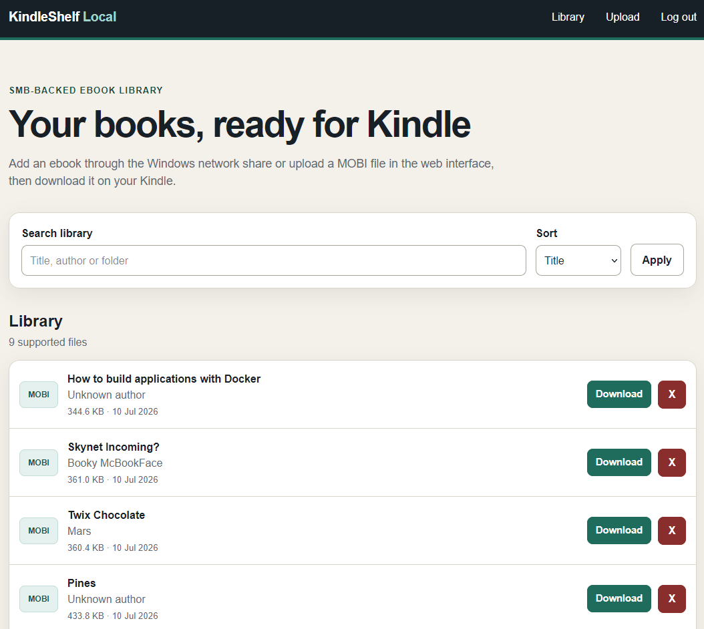

<p align="center">
  
</p>

<h1 align="center">KindleShelf Local</h1>

<p align="center">
  A private, self-hosted ebook library built for the Kindle web browser.<br>
  Drop DRM-free books into a Windows share, then tap <strong>Download</strong> on your Kindle.
</p>

<br>

<p align="center">
  
</p>

<br>

## Contents

- [Features](#features)
- [How it works](#how-it-works)
- [Quick start](#quick-start)
- [Configuration](#configuration)
- [Ports](#ports)
- [Using KindleShelf](#using-kindleshelf)
- [Reverse proxy](#reverse-proxy)
- [Updating](#updating)
- [Backup](#backup)
- [Troubleshooting](#troubleshooting)
- [Development](#development)
- [Licence](#licence)

<br>

## Features

- Simple single-column pages that work in the Kindle browser
- Windows SMB share (`\\SERVER-IP\KindleShelf`) for adding books
- Web upload page for `.mobi` files
- On-demand conversion to MOBI with Calibre, with a cache so each book converts once
- Search and sort by title, newest or format
- Remove books from the library (with a confirmation page)
- Optional PIN, with a lockout after 5 wrong attempts
- Runs on amd64 and arm64 (Ubuntu or Raspberry Pi)

Supported source formats: AZW, AZW3, DOCX, EPUB, FB2, HTM, HTML, MOBI, ODT, PDF, PRC, RTF and TXT.

> [!IMPORTANT]
> Only DRM-free files can be converted. KindleShelf does not remove or bypass DRM.

<br>

## How it works

Two containers share one `library/` folder:

| Container | Image | Job |
| --- | --- | --- |
| `kindleshelf-local` | Built from this repo (Flask, Gunicorn, Calibre) | Web library, uploads, MOBI conversion |
| `kindleshelf-smb` | `dockurr/samba` | Windows network share for the same folder |

Both run as `PUID`:`PGID`, so files added over SMB can be removed from the web page and the other way round.

<br>

## Quick start

```bash
git clone https://github.com/pqpxo/KindleShelf.git kindleshelf
cd kindleshelf
cp .env.example .env
nano .env
```

Set at least `APP_PIN` and `SMB_PASSWORD`, and set `PUID`/`PGID` to the output of `id -u` and `id -g`. Then start it:

```bash
docker compose up -d --build
```

Open `http://SERVER-IP:8112` and enter your PIN.

> [!TIP]
> Leave `SECRET_KEY` blank. KindleShelf creates a random key on first start and keeps it in `data/secret_key`, so logins survive restarts.

> [!WARNING]
> Anyone who can open the site can upload and delete books. Set `APP_PIN`, and keep the site on your LAN, a VPN or behind a proxy access list.

<br>

## Configuration

All settings live in `.env`. Copy `.env.example` to start.

| Variable | Default | Description |
| --- | --- | --- |
| `TZ` | `Europe/London` | Time zone |
| `PUID` / `PGID` | `1000` | User and group that own `library/` and `data/` on the host |
| `WEB_PORT` | `8112` | Host port for the web page |
| `SECRET_KEY` | blank | Signs login cookies. Blank = auto-generated and saved in `data/secret_key` |
| `APP_PIN` | blank | PIN needed to use the site. Blank = no login (not recommended) |
| `SESSION_COOKIE_SECURE` | `false` | Set `true` only if every visit is over HTTPS |
| `CONVERSION_TIMEOUT_SECONDS` | `300` | Stop a Calibre conversion after this long (minimum 30) |
| `MAX_UPLOAD_SIZE_MB` | `100` | Largest file the upload page accepts |
| `SMB_USER` | `kindle` | Username for the Windows share |
| `SMB_PASSWORD` | none | **Required.** Password for the Windows share |

<br>

## Ports

| Port | Service | Notes |
| --- | --- | --- |
| `8112` (`WEB_PORT`) | Web library | Container listens on `8080` |
| `445` | SMB share | Windows uses this port, so it cannot be changed |

<br>

## Using KindleShelf

**Add books**

- From Windows, open `\\SERVER-IP\KindleShelf` in File Explorer and sign in with `SMB_USER` and `SMB_PASSWORD`. Subfolders are fine.
- Or open **Upload** in the web page and choose a `.mobi` file. If the name already exists, KindleShelf saves it as `Book (2).mobi`.

**Download on Kindle**

1. Open `http://SERVER-IP:8112` in the Kindle browser.
2. Search if needed, then tap **Download** beside the book.
3. Accept the Kindle download prompt.

Non-MOBI books are converted the first time you download them, which can take a minute on a Raspberry Pi.

> [!TIP]
> Name files `Title - Author.epub` (or `Title by Author.epub`) and KindleShelf shows the title and author separately.

**Remove books**

Tap **X** beside a book and confirm. This deletes the file from `library/` and its cached MOBI. It cannot be undone, so keep a backup.

<br>

## Reverse proxy

KindleShelf trusts `X-Forwarded-*` headers from one proxy, so it works behind Nginx Proxy Manager or Caddy.

For Nginx Proxy Manager, create a Proxy Host with scheme `http`, forward host `SERVER-IP`, forward port `8112`, **Block Common Exploits** on and your SSL certificate with **Force SSL**.

> [!NOTE]
> Leave `SESSION_COOKIE_SECURE=false` if you also use `http://SERVER-IP:8112` on your LAN. Browsers do not send secure cookies over plain HTTP, so logins and uploads fail with "Invalid request".

<br>

## Updating

```bash
cd kindleshelf
git pull
docker compose up -d --build
```

Your `.env`, `library/` and `data/` folders are kept.

> [!WARNING]
> From 1.2.3, `SMB_PASSWORD` must be set or Compose will refuse to start. If your `.env` still has `SECRET_KEY=replace-with-a-long-random-value`, KindleShelf now ignores it and generates a new key, so you will need to log in again.

<br>

## Backup

| Folder | Contents | Needed? |
| --- | --- | --- |
| `library/` | Your ebooks | Yes |
| `.env` | Settings and passwords | Yes |
| `data/` | Secret key and MOBI cache | Optional, the cache rebuilds itself |

<br>

## Troubleshooting

| Problem | Fix |
| --- | --- |
| "Invalid request" when uploading or logging out | See the note in [Reverse proxy](#reverse-proxy) about `SESSION_COOKIE_SECURE`. Refresh the page and try again |
| "does not have write permission" when uploading or removing | Set `PUID`/`PGID` to the folder owner, then run `sudo chown -R "$(id -u):$(id -g)" library data` |
| Conversion failed | The file is damaged or DRM-protected. Check `docker compose logs kindleshelf` |
| Conversion times out on a Pi | Raise `CONVERSION_TIMEOUT_SECONDS` |
| "Too many incorrect attempts" | Wait 15 minutes, or run `docker compose restart kindleshelf` |
| Compose says `Set SMB_PASSWORD in .env` | Add a password for the Windows share to `.env` |
| Windows cannot reach the share | Check nothing else on the host uses port 445 (for example, a Samba install on the host) |

Health check:

```bash
docker compose ps
```

The web container reports `healthy` when `/health` responds. `/health` also shows `library_writable`.

<br>

## Development

```bash
pip install -r requirements.txt pytest
python -m pytest -q tests
```

The smoke tests run without Calibre or Docker. GitHub Actions runs them on every push, along with `docker compose config`.

<br>

## Licence

[MIT](LICENSE)
